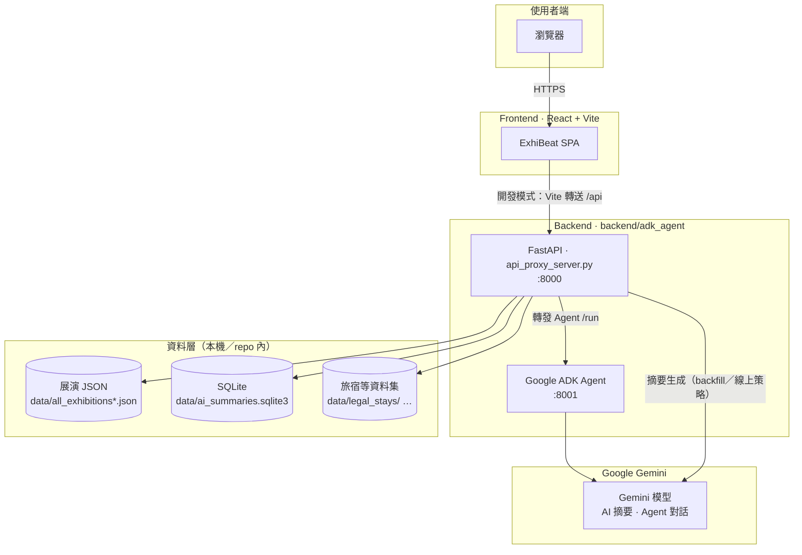

# ExhiBeat | 台北展演整合平台

*競賽／計畫：**YTP 少年圖靈計畫** · 本 repo 產品名稱：**ExhiBeat***


把「分散在不同網站、社群、票務頁面」的展演資訊，整合成一個可搜尋、可比較、可推薦、可規劃的體驗。

---

## 核心內容

- **展演整合**：集中多來源活動內容，降低找活動的時間成本
- **多元探索**：用關鍵字、標籤、地圖三種視角快速篩選
- **AI 增強推薦**：透過 AI Agent 與推薦邏輯，協助你找到更符合偏好的活動
- **從發現到決策**：不只看清單，還能收藏、比較、規劃行程

使用流程：
1. 打開首頁看推薦
2. 用搜尋 + `#標籤` 篩選
3. 進詳情頁看內容與地圖
4. 用收藏與 AI 助手做下一步決策

---

## 為什麼需要 ExhiBeat


在台北，展演資訊充足，但缺乏整合品質一致且可快速決策的平台。

常見痛點：

- 資訊分散在官方網站、售票平台、社群貼文
- 使用者需要反覆切頁比對內容、地點、時間
- 很難在短時間內找到「真的適合自己」的活動

ExhiBeat 的價值是把這條路徑縮短：

**彙整資料 → 快速探索 → 個人化推薦 → 直接決策**

---

## Live View

[Live view](https://frontend-rho-five-45.vercel.app/)

---

## 系統架構圖



說明：

- 前端透過 **Vite dev proxy** 將 `/api` 轉到本機 **8000**；生產環境請將 API 對應到同一支 FastAPI 服務。
- **AI 展覽簡介**多數為預先寫入 **SQLite** 的多語摘要；**聊天助手**由 **ADK + Gemini** 處理。
- 可選環境變數見下方「環境變數」一節（TDX、Maps 等）。

---

## 本機開發 Quick Start

### 環境需求

- **Python** 3.11 或 3.12（後端）
- **Node.js** 22+、**npm**（前端）
- 可執行 **bash** 的環境（macOS / Linux / **Git Bash** / WSL），以便跑 `scripts/*.sh`

依賴宣告：

| 位置 | 用途 |
|------|------|
| `frontend/package.json` | 前端套件 |
| `backend/adk_agent/requirements.txt` | FastAPI、代理、摘要管線 |
| `backend/app/recommender/requirements.txt` | 進階推薦（**選配**） |

---

### 環境變數（評審／本機必看）

#### 後端（必填 Gemini 路徑之一）

複製範本並編輯：

```bash
cp backend/adk_agent/gemini_agent/.env.sample backend/adk_agent/gemini_agent/.env
```

`backend/adk_agent/gemini_agent/.env` 重點變數（**擇一**設定即可跑通摘要與 Agent）：

| 變數 | 說明 |
|------|------|
| `GOOGLE_GENAI_USE_VERTEXAI` | `0` = [Google AI Studio](https://aistudio.google.com/app/apikey) API Key；`1` = Vertex AI（需 GCP） |
| `GOOGLE_API_KEY` | AI Studio 金鑰（`VERTEXAI=0` 時使用） |
| `GOOGLE_CLOUD_PROJECT` / `GOOGLE_CLOUD_LOCATION` | Vertex 時必填（例：`us-central1`） |
| `GEMINI_MODEL` | 預設可為 `gemini-2.5-flash`（以 `.env.sample` 為準） |
| `TDX_CLIENT_ID` / `TDX_CLIENT_SECRET` | **選配**，大眾運輸資料 |
| `GOOGLE_MAPS_API_KEY` | **選配**，後端若需 Places 等 |

完整註解見：`backend/adk_agent/gemini_agent/.env.sample`。

#### 前端（選配）

地圖與樣式相關（沒設仍可跑大部分頁面，**地圖頁**會提示缺少 key）：

```bash
cp frontend/.env.local.sample frontend/.env.local
```

| 變數 | 說明 |
|------|------|
| `VITE_GOOGLE_MAPS_API_KEY` | Google Maps JavaScript API |
| `VITE_GOOGLE_MAP_ID` | 向量地圖樣式（選配） |
| `VITE_API_PROXY_TARGET` | 本機 API 位址，預設 `http://127.0.0.1:8000`；WSL 連 Windows 時可改 IP |

---

### 安裝與啟動

在**專案根目錄**：

```bash
# 前端依賴
cd frontend && npm install && cd ..

# 後端 venv + pip + 建立 gemini_agent/.env（若尚無）
bash scripts/setup_backend.sh

# 同時啟動 API Proxy :8000 與 ADK Agent :8001
bash scripts/start_backend.sh
```

**另開**一個終端機：

```bash
bash scripts/start_frontend.sh
```

預設網址：

| 服務 | URL |
|------|-----|
| 前端（Vite） | <http://127.0.0.1:5173> |
| FastAPI | <http://127.0.0.1:8000> |
| ADK Agent | <http://127.0.0.1:8001> |

**Windows**：若無 bash，可於 `backend/adk_agent` 手動建立 `.venv`、`pip install -r requirements.txt`，再分別用 `uvicorn` 啟動 `api_proxy_server` 與 ADK（建議仍安裝 Git Bash 以沿用腳本）。

---

### 預先產生 AI 摘要（選配）

多語摘要快取寫入 `data/ai_summaries.sqlite3`（預設 **gitignore**）。本機可執行：

```bash
backend/adk_agent/.venv/Scripts/python.exe -u scripts/backfill_ai_summaries.py --all-locales --force
```

（Linux/macOS 將路徑改為 `.venv/bin/python`；需已設定好 `gemini_agent/.env`。）

---

## 技術棧對照（簡表）

| 層級 | 主要技術／路徑 |
|------|----------------|
| 前端 | React、Vite、TypeScript、`frontend/` |
| API 閘道 | FastAPI、`backend/adk_agent/api_proxy_server.py` |
| AI 助手 | Google ADK、`backend/adk_agent/gemini_agent/` |
| 展演資料 | `data/all_exhibitions.json`、多語系 `all_exhibitions_*.json` |
| AI 摘要快取 | SQLite、`data/ai_summaries.sqlite3` |
| 資料擷取 | `crawler/` |
| 進階推薦（選配） | `backend/app/recommender/` |
